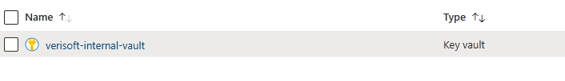
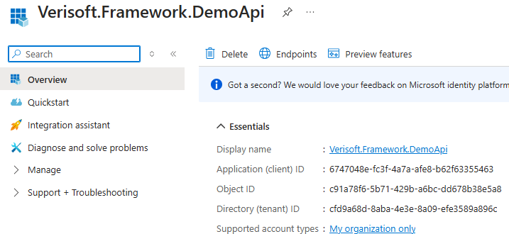

# Appsettings

Konfiguraci načítáme z `appsettings.json` a odpovídajícího souboru prostředí
`appsettings.{Environment}.json`. V aktuálním Demo API jsou použity zejména
`DevelopmentDocker`, `DEV` a `DEVExternal`.
Příklad:
**appsettings.json**
appsettings.**DevelopmentDocker**.json - Docker Compose
appsettings.**DEV**.json
appsettings.**DEVExternal**.json

obecné appsetitngs:
``` js
//může obsahovat i další, pouze ilustrativní příklad
{
  "Logging": {
    "LogLevel": {
      "Default": "Information",
      "Microsoft.AspNetCore": "Information"
    }
  },
  "HangfireJobs": {
    "JobOneSettings": "0 0 * * *",
    "JobTwoSettings": "0 1 * * *"
  },
  "AllowedHosts": "*",
  "apiSecret": "KEY_TO_DECODE_JWT_TOKEN"
}
```

pro specifické prostředí pak používáme konkrétní settings:

``` js
{
  "Database": {
    "ConnectionString": "CONNECTION_STRING_FOR_DEV"
  },
  "Kestrel": {
    "EndPoints": {
      "Http": {
        "Url": "http://0.0.0.0:80"
      }
    }
  }
}
```
pokud nechceme uchovávat citlivé konfigurace v appsettings.json je možné využít Azure Key Vault:
Předpokladem je založený Azure Key Vault + App registrace v azure portále



Po založení key vault a app registrace je možné propojení key vaultu a aplikace v nastavení key vault.

V .net aplikaci je pak možné číst key vault secrets, stejně jako kdyby šlo a hodnoty v appsettings:
Například výše uvedený Database.ConnectionString bude v KV zapsán takto:


v Program.cs je nutné zaregistorvat KV:

``` csharp
var builder = WebApplication.CreateBuilder(args);
builder.AddAzureKeyVault(builder.Configuration);
```

v appsettings.json:
``` js
  "KeyVault": {
    "Uri": "https://verisoft-internal-vault.vault.azure.net/",
  },
  "AzureAd": {
    "TenantId": "<TenantId>",
    "ClientId": "<ClientId>",
  }
```

Pro spojení je nutné ještě definovat ClientSecret. Ideálně by neměl být uložen v appsettings čím opět vystavujeme citlivé údaje.
Takže doporučuji si ho nastavit do například do env variables:


## Typované konfigurace (`Verisoft.Core.Configuration`)

Pro typované/validované čtení konfigurace (namísto `IConfiguration["Key"]`)
lze použít `ConfigurationExtensions.AddConfiguration<TInterface, TClass>()`
(`Verisoft.Core.Configuration`). Metoda navěsí sekci konfigurace (dle názvu
`TClass`, nebo explicitního `name`) na `TClass` pomocí `Options` patternu
(`BindConfiguration` + `ValidateDataAnnotations` + `ValidateOnStart`) a
zaregistruje `TInterface` jako singleton, jehož hodnota se vytváří přes
`IOptions<TClass>.Value` – tedy chybná konfigurace shodí start aplikace
(`ValidateOnStart`), ne až první použití.

```csharp
services.AddConfiguration<IMySettings, MySettings>();
```

(`MySettings` je zde ilustrativní příklad; ve zdrojovém kódu není žádné
konkrétní použití této metody, `HealthConfiguration` se registruje jinak,
viz [Monitoring](Monitoring.md)).
