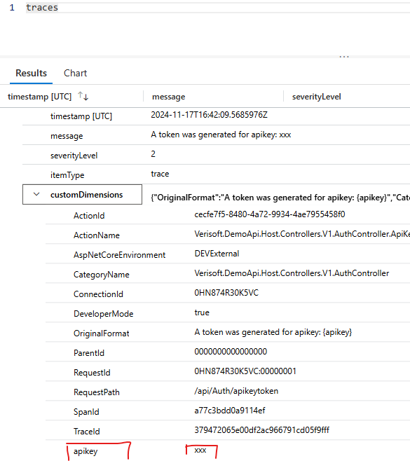

Setup viz monitoring
Nuget:
Ve stručnosti používáme `Verisoft.Core.ApplicationInsights` a v něm `Microsoft.ApplicationInsights`


Pro logování využíváme `ILogger<Type>`
Příklad logování:
``` csharp
public async Task<IActionResult> ApiKeyToken([FromQuery] string apikey)
{
    try
    {
        var user = await userService.GetUserByApiKeyAsync(apikey);
        if (user == null)
        {
            logger.LogWarning("No user found for apikey: {apikey}", apikey);
            return new UnauthorizedResult();
        }

        var token = await tokenService.Generate(user);
        var result = new AuthenticatedResponse()
        {
            Token = token,
        };

        logger.LogInformation("A token was generated for apikey: {apikey}", apikey);

        return Ok(result);
    }
    catch (Exception ex) {
        logger.LogError(ex, "Error when generating token for apikey: {apikey}", apikey);
        throw;
    }
}
```

V appsettings.json si můžu nastavit jaký level logů se mi bude odesílat do application insights a jaký level uvidím například v konzoli nebo application insights:
Více informací dle dokumentace Microsoft: https://learn.microsoft.com/en-us/aspnet/core/fundamentals/logging/?view=aspnetcore-8.0

Defaultně není nutné definovat ApplicationInsights (ale loguje až od warnign výše, z důvodů úspory přenesených dat)
``` js
"Logging": {
    "LogLevel": {
      "Default": "Information",
      "Microsoft.AspNetCore": "Information",
      "Microsoft.Hosting.Lifetime": "Information",
      "Microsoft.EntityFrameworkCore.Database.Command": "Information"
    },
    "ApplicationInsights": {
      "LogLevel": {
        "Default": "Information",
        "Microsoft": "Information"
      }
    }
  },
```


Pro logování NEPOUŽÍVÁME interpolaci, ale logovací parametry viz výše. (Důvodem je performance a také možnost pak hledat dle logovaných parametrů v application insights)


Logování uživatelských akcí:
`logger.LogInformation("User: {userId} updated XY: {entityId}", userId, entityId);`

Logování systémových akcí:
`logger.LogInformation("System started process XY with parameter: {param1}", param1);`

Logování komunikace s třetí stranou provádějte strukturovaně a vždy uveďte
identifikátor operace, cílovou službu a výsledek. Tajné hlavičky a tokeny se
nelogují.

Do souborů u kontejnerů nelogujeme.
Pokud potřebujete jiné logování než do Application Insights (například zákazník
nechce posílat logy do cloudu), použijte logger provider schválený pro dané
nasazení.
https://medium.com/@brucycenteio/adding-serilog-to-asp-net-core-net-7-8-5cba1d0dea2