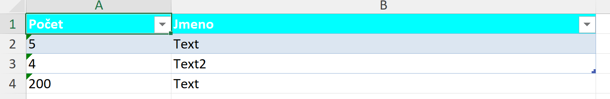

Pokud potřebuji exportovat základní data do excelu je možné využít `Verisoft.Core.Export.Excel` (projekt `Verisoft.Core.Export`, třída `ExcelExport<TData>`).


Příklad generování excelu:
``` csharp
//record TestDataRecord
private record TestDataRecord(string StringValue, int IntValue);

public void ShouldCreateFileWithSetValues()
{
    List<TestDataRecord> data = [new TestDataRecord("Text", 5), new TestDataRecord("Text2", 4), new TestDataRecord("Text", 200)];

    using var fileStream = new FileStream("./test.xlsx", FileMode.Create, FileAccess.Write);
    var settings = new ExportBuilder<TestDataRecord>()
        .Header(x => x.Background(Color.Aqua))
        .Column(x =>
        {
            x.PropertyExpression(y => y.IntValue);
            x.Type(typeof(int));
            x.Header("Počet");
            x.Width(20);
        })
        .Column(x =>
        {
            x.PropertyExpression(y => y.StringValue);
            x.Type(typeof(string));
            x.Header("Jmeno");
            x.Width(60);
        })
        .Build();

    new ExcelExport<TestDataRecord>(data, settings).Export(fileStream);
}
```

Nastavení (`ExportSettings<TData>`) se sestavuje pomocí `ExportBuilder<TData>`
(`Verisoft.Core.Export.Builders`) a předává se do konstruktoru `ExcelExport<TData>`
spolu s daty; teprve poté se volá `Export(stream)`.

Výsledný excel:


Pokud nejsou konfigurovány header/columns tak se používají defaultní hodnoty.